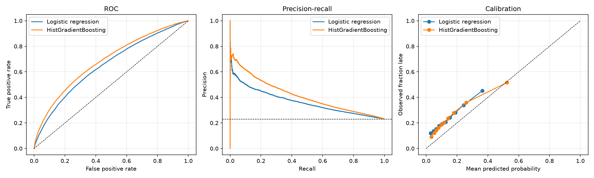

# Flight Delay Prediction

Predicting whether a flight out of NYC (EWR, JFK, LGA) will arrive 15+ minutes late, with an emphasis on **leakage-aware features** and **honest, time-based evaluation**.

Data: [nycflights13](https://github.com/tidyverse/nycflights13) — 336,776 flights from 2013 joined with hourly airport weather (downloaded automatically).

## Key ideas

- **Two prediction scenarios**, enforced in code (`features.py`):
  - `scheduled` — predict at schedule time using only the timetable, route, congestion and weather for the scheduled hour.
  - `departure` — predict at pushback; adds `dep_delay`, which is unknown until the plane leaves the gate. Including it in the first scenario would be target leakage.
- **Chronological split**: train on Jan–Sep, test on Oct–Dec. A random split lets the model see the same weather systems on both sides and inflates scores.
- **Models**: prior baseline (floor), logistic regression (one-hot + scaling), and histogram gradient boosting (native categorical + missing-value handling).
- **Metrics**: ROC-AUC, PR-AUC (the classes are imbalanced, ~23% late), Brier score, calibration curves, permutation importance.

## Results (test set: Oct–Dec 2013, 82,609 flights, 23.0% late)

| Scenario | Model | ROC-AUC | PR-AUC | Brier ↓ |
|---|---|---|---|---|
| scheduled | Prior baseline | 0.500 | 0.230 | 0.177 |
| scheduled | Logistic regression | 0.651 | 0.365 | 0.175 |
| scheduled | HistGradientBoosting | **0.684** | **0.414** | **0.168** |
| departure | Prior baseline | 0.500 | 0.230 | 0.177 |
| departure | Logistic regression | 0.885 | 0.816 | 0.090 |
| departure | HistGradientBoosting | **0.886** | 0.810 | 0.091 |

What the numbers say:

- Predicting delays **before departure is hard** (AUC ≈ 0.68). Gradient boosting beats the linear baseline there, so there is non-linear structure (scheduled time of day dominates permutation importance, followed by weather and carrier).
- Once `dep_delay` is known, the problem is mostly solved by it (permutation importance ≈ 0.32 AUC, ~30× any other feature) and a linear model is as good as boosting.
- Calibration plots show the models under-predict lateness at the low end on the Oct–Dec test window, a sign of seasonal distribution shift worth studying further.

Figures: [`reports/figures/`](reports/figures) (ROC / PR / calibration and importance per scenario). Raw metrics: [`reports/`](reports).



## Reproduce

Requires Python 3.10+.

```bash
make setup   # creates .venv and installs the package
make train   # downloads data (~35 MB), trains both scenarios, writes reports/
make test    # unit tests (no network needed)
```

## Layout

```
src/flightdelay/
  data.py        download + load CSVs
  features.py    scenarios, target, weather join, chronological split
  models.py      baseline, logistic regression, gradient boosting
  evaluate.py    metrics and plots
  train.py       CLI entry point
tests/           leakage, join, split and target-definition tests
reports/         metrics JSON + figures from the last run
```

## Limitations and next steps

- One year of data from three airports; results may not transfer to other airports or years.
- Weather is only for the origin airport. Adding destination weather and upstream (inbound aircraft) delays — via `tailnum` chaining — is the most promising extension, since late-arriving aircraft are a major cause of delay propagation.
- No hyperparameter search beyond early stopping; a time-series cross-validation sweep would be a natural follow-up.
